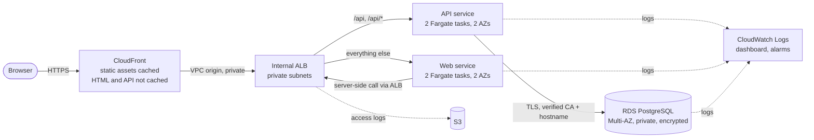

# Three-tier Node application on AWS

A scalable, secure deployment of the sample web → API → PostgreSQL application, with infrastructure as code, continuous delivery, backups, central logs and metrics.

**Status:** deployed, load-tested, failed over and then deliberately torn down to stop costs, so there is no live URL. The Terraform, pipeline and runbooks here reproduce it (see [docs/operations.md](docs/operations.md) and [docs/costs.md](docs/costs.md)).

Every page view runs a real database query: the time shown and the request UUID change on each request.

## Architecture



| Tier | Implementation |
| --- | --- |
| Edge | CloudFront with the default `*.cloudfront.net` certificate. HTTP redirects to HTTPS; security headers added. `/stylesheets/*` and `/images/*` are cached; HTML and `/api/*` are never cached. |
| Load balancing | One **internal** Application Load Balancer in private subnets, reached by CloudFront through a VPC origin. `/api` and `/api/*` go to the API, everything else to web. Not reachable from the internet. |
| Web and API | Separate ECS Fargate services, 2 tasks each spread across two Availability Zones, 0.25 vCPU / 512 MiB per task. Non-root, read-only containers; images pinned by digest. |
| Database | RDS PostgreSQL 16, Multi-AZ with one standby, private, encrypted, TLS required. The application uses a read-only, least-privilege login; the master password is managed by RDS in Secrets Manager. |
| Network | VPC across `use1-az1` and `use1-az2`. Tasks in public subnets with public IPv4 for outbound calls only (no NAT gateway); every inbound path is limited by security groups to the load balancer. |

More detail, including failure and update behaviour: [docs/architecture.md](docs/architecture.md). Architecture slides: [docs/slides/architecture.pdf](docs/slides/architecture.pdf). The plan, with how each requirement was interpreted and the decisions taken: [plan.md](plan.md).

## Repository layout

| Path | Contents |
| --- | --- |
| `web/`, `api/` | The application, with tests and a Dockerfile per service |
| `infra/bootstrap/` | Terraform for the encrypted, versioned S3 state bucket (native state locking) |
| `infra/stack/` | Terraform for everything else: network, IAM, ECR, RDS, ECS, ALB, CloudFront, monitoring |
| `.gitlab-ci.yml` | Pipeline: tests and plan on every branch; build and rolling release on `main` |
| `scripts/release/` | Image build/push and the verified rolling release with rollback |
| `scripts/runtime/` | Operations: status, private probe, scale, start, stop, database initialization, teardown |
| `scripts/backup/` | Backup status, on-demand backup, database verification and an isolated restore drill |
| `tests/system/` | Local integration (PostgreSQL + TLS, containers) and in-VPC failure tests |
| `deploy/images.json` | Image digests used for the first deployment |
| `docs/contracts/application.md` | Application configuration, health, timeout and logging contract |
| `docs/slides/` | Architecture presentation (HTML source and PDF) |
| `plan.md` | Delivery plan: requirements, decisions and acceptance criteria |

## Run and test locally

Requires Node 24.21.0 (see `.nvmrc`) and Docker.

```bash
(cd api && npm ci && npm test)
(cd web && npm ci && npm test)
bash scripts/check-local.sh   # unit tests, PostgreSQL/TLS integration, production images
```

`check-local.sh` builds both production images (linux/amd64) and checks them against a disposable PostgreSQL with TLS: request path, image hardening, capacity at the deployed task size, database outage and recovery, and graceful shutdown. All test resources are removed afterwards, also on failure.

## Deploy

All infrastructure is Terraform. From a clean AWS account (`us-east-1`):

```bash
# 1. State bucket (first run uses local state, then migrates into the bucket)
cd infra/bootstrap
cp local_override.tf.example local_override.tf && terraform init && terraform apply
cp backend.hcl.example backend.hcl            # set bucket = $(terraform output -raw state_bucket)
rm local_override.tf && terraform init -migrate-state -backend-config=backend.hcl

# 2. Foundation: network, IAM, ECR, database, cluster, load balancer, CDN; no serving tasks yet
cd ../stack
cp backend.hcl.example backend.hcl && terraform init -backend-config=backend.hcl
terraform apply -var services_enabled=false

# 3. Images, then the one-off operator task that creates the read-only database login
cd ../..
scripts/release/build-push.sh                                  # records digests in deploy/images.json
terraform -chdir=infra/stack apply -var services_enabled=false # registers the operator task with the image
scripts/runtime/init-database.sh

# 4. Serving tasks (default services_enabled=true), then a private end-to-end check
terraform -chdir=infra/stack apply
scripts/runtime/probe.sh
```

Services are created only in step 4, after the images exist and the database login works. The default `services_enabled=true` is what every later plan and apply uses, so a normal run never removes the serving tasks. This order was derived from the resource dependencies, not executed in a fresh account.

After the first deployment, releases go through the pipeline.

## Continuous delivery

| Stage | What happens | Where |
| --- | --- | --- |
| test | unit tests of both services; check that CI can reach AWS and is read-only on branches | every branch |
| plan | `terraform plan` with a read-only role | every branch |
| build | linux/amd64 images pushed to ECR, tagged with the commit (immutable tags) | `main` |
| release | API, then web: new task definition revision with only the image changed, rolling update (new tasks healthy before old ones drain), ECS circuit breaker, public smoke test, rollback on failure | `main` |
| infra | apply the reviewed plan | `main`, manual |

CI uses scoped roles: plan (read-only), release (images and ECS services only), infra (project-scoped). The GitLab instance issues no OIDC ID tokens, so jobs reach these roles through CI users that may only assume them; their keys are masked variables, and the deploy keys are protected (available on `main` only). The OIDC trust is in place for servers that do issue ID tokens.

## Operations

```bash
scripts/runtime/status.sh                      # services, target health, images, database, public URL
scripts/runtime/probe.sh                       # one-off task inside the VPC: page, API, readiness
scripts/runtime/scale.sh web 3                 # approved counts 2-4, waits until stable
scripts/runtime/stop.sh --confirm-outage       # both services to 0 (live outage)
scripts/runtime/start.sh                       # back to 2 + 2
scripts/backup/status.sh                       # backup configuration and newest snapshot age
scripts/backup/backup-now.sh                   # on-demand DB snapshot + state bucket backup
scripts/backup/restore-drill.sh                # restore to a temporary instance, verify, delete
scripts/release/deploy.sh api <image@digest>   # manual release with the same checks as CI
```

**Logs and metrics:** CloudWatch dashboard `three-tier` (CloudFront, ALB, targets, ECS, RDS); alarms for unhealthy targets, 5xx responses, CloudFront error rate and database CPU, sent to SNS topic `three-tier-alarms`. Saved Logs Insights queries: `three-tier/api-errors`, `three-tier/slow-requests`, `three-tier/trace-request-id`, `three-tier/task-lifecycle`. Every request is logged as JSON with a request ID; the API's ID is the `request_uuid` shown on the page. ALB access logs go to S3 and CloudFront access logs to CloudWatch.

## Measured behaviour

Measured inside the VPC with a sampler requesting `/` and `/api/status` every 500 ms:

| Event | Result |
| --- | --- |
| One web task stopped | 0 failed requests; replacement healthy in 45 s |
| One API task stopped | 0 failed requests; replacement healthy in 68 s |
| Rolling release (API, then web) | 0 failed requests |
| Database engine upgrade 16.14 → 16.15, including a rollback test | 0 failed out of 3,598 requests over 15 minutes |
| Database Multi-AZ failover | about 17 s of fast HTTP 503 responses (max ~1 s each), then automatic recovery; no task restarts |
| Point-in-time restore drill | restored copy available in 20 minutes and verified, then deleted |
| Scheduled daily backup | automated snapshots taken at 02:08 UTC, inside the 02:00–03:00 window |

During a database outage, requests fail quickly with HTTP 503 instead of hanging: each API request is bounded to 3 s and each web request to 5 s. Liveness checks never depend on the database, so a database failover does not make ECS replace healthy tasks.

## Security

- Database, load balancer and tasks are not reachable from the internet; the only public entry is CloudFront.
- TLS from the API to PostgreSQL, verified against the RDS certificate authority and the endpoint hostname.
- Read-only application database login; the master credential is used only by a one-off initialization task.
- Secrets are injected by ECS from Secrets Manager; none are in Git, images, Terraform variables or logs.
- Least-privilege IAM per service; task roles have no permissions; the web service cannot read the database secret.
- Containers run as a non-root user with a read-only filesystem. Images are scanned on push (Alpine base: no findings at the last scan).
- Encryption at rest for RDS, S3 and ECR; private, TLS-only S3 buckets.

## Backups and recovery

| Storage | Backup | Retention |
| --- | --- | --- |
| PostgreSQL | RDS automated backups daily in 02:00–03:00 UTC, with point-in-time recovery | 7 days |
| Terraform state (S3) | Object versioning, plus a daily AWS Backup copy at 03:30 UTC into the `three-tier-backups` vault | versions 90 days; backups 7 days |
| Container images | Rebuilt from Git; immutable tags in ECR | newest 20 per repository |
| Secrets | The app password is recreated by `scripts/runtime/init-database.sh`; the master password is managed by RDS | — |

`scripts/backup/backup-now.sh` takes an on-demand database snapshot and a state-bucket backup and waits for both. `scripts/backup/restore-drill.sh` restores the latest restorable point into a separate temporary instance, verifies it with `scripts/backup/verify-db.sh` (TLS, application login, read-only), and deletes it.

## Database engine updates

Engine updates do not modify the serving database in place. A new database generation is restored from the serving one and upgraded while the original keeps serving. A configuration release (`scripts/release/deploy.sh api --revision <task definition>`) then rolls the API onto it, healthy-before-drain; the old generation stays available for rollback and is retired afterwards with a final snapshot. This avoids the restart of an in-place upgrade, and relies on the application being read-only. Generations are declared in `infra/stack/variables.tf` (`db_generations`, `active_db_generation`).

Performed: 16.14 → 16.15. Sampled for 15 minutes across a rollback to the old generation and the move to the new one: 0 failed requests out of 3,598.

## Limitations

- **Database failover:** an unplanned Multi-AZ failover still causes a short interruption (about 17 s measured); requests fail fast and recover automatically.
- **No custom domain:** the default CloudFront certificate is used, and AWS fixes its minimum TLS version at 1.0, although clients negotiate TLS 1.2/1.3. A custom domain with an ACM certificate would allow a stricter minimum.
- **No autoscaling:** capacity is a fixed baseline of 2 + 2 tasks, with scripted scaling (2–4). Measured at the deployed size: 200 requests at concurrency 20 with no failures.

## Teardown

```bash
scripts/runtime/teardown.sh --confirm-destroy
```

This deletes the CI user keys, removes deletion protection and destroys the stack. RDS takes a final snapshot first. The Terraform state bucket is kept until it is deleted by hand.

## Source

The application is based on a sample three-tier Node app (`node-3tier-app2`, upstream commit `c4bb3e6`); the infrastructure, delivery, backup and operations work around it is the focus of this repository.
