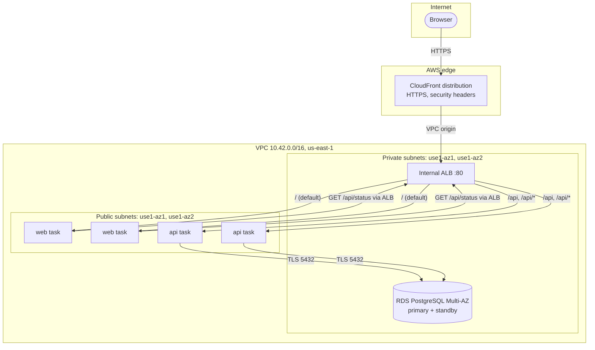

# Architecture

## Request path

1. CloudFront terminates HTTPS. It serves cached static assets, and forwards everything else to the internal ALB through a VPC origin. HTML and API responses are never cached, because each one carries a fresh database timestamp.
2. The ALB routes `/api` and `/api/*` to the API target group, and everything else to web.
3. Web renders the page server-side after calling `/api/status` through the same ALB. This call has a 5 s budget and validates the response.
4. The API runs `SELECT now()` through a pool of up to 5 connections per task, over TLS verified with the RDS CA and the endpoint hostname. Each request has a 3 s budget (1 s to acquire a connection, 1 s per query), with at most one retry for connection errors.

## Security boundaries

| From | To | Allowed |
| --- | --- | --- |
| Internet | CloudFront | HTTPS (HTTP redirects) |
| CloudFront VPC origin | ALB | TCP 80 (only the CloudFront-managed security group) |
| ALB | web, API tasks | TCP 3000 |
| web tasks, probe tasks | ALB | TCP 80 |
| API tasks | RDS | TCP 5432, TLS required by the server |
| tasks | AWS service endpoints | TCP 443 outbound (ECR, CloudWatch Logs, Secrets Manager) |

Nothing else is allowed in. The tasks' public IPv4 addresses exist only for outbound access, which avoids a NAT gateway; their port 3000 is closed to the internet. The ALB and RDS resolve only to private addresses.

Identities: each service has its own execution role (image pull, its own log group, and for the API only, its database secret) and a task role with no permissions. CI roles are separated into plan (read-only), release (images and ECS services) and infra (project-scoped changes, cannot alter the state bucket's protections).

## Availability

| Failure | Behaviour | Measured |
| --- | --- | --- |
| A task crashes or is stopped | ALB stops routing to it; ECS starts a replacement; the other task in the second AZ keeps serving | 0 failed requests; replacement healthy in 45–68 s |
| An Availability Zone is lost | each service has one task per AZ, and RDS has a standby in the other AZ | (by design; not simulated) |
| Database primary fails | RDS promotes the standby. The API returns HTTP 503 quickly while the endpoint moves, and its pool reconnects to the new primary by itself | ~17 s of 503 responses during a forced failover; no task restarts |
| Database unreachable for longer | `/health/ready` reports 503, but `/health/live` stays 200, so ECS does not replace every healthy task in a loop; the application recovers by itself | tested locally and in AWS |
| Bad release | new tasks must pass health checks before old ones drain; the ECS circuit breaker and the release script roll back | rolling releases: 0 failed requests |

Health: the ALB checks `/health/live` (process only). `/health/ready` checks the real dependency (API → database, web → API) and is what startup admission and release verification use. On SIGTERM, tasks stop accepting connections, finish in-flight requests, close the pool and exit within 20 s; the ALB deregistration delay is 15 s.

## Updates

**Application:** rolling updates with minimum healthy 100% and maximum 200%, so capacity never drops below 2 tasks per service. Images are immutable and deployed by digest.

**Database engine:** the serving database is never upgraded in place. A new generation is restored from the serving one and upgraded while the original keeps serving. The API then rolls over to the new endpoint, again healthy-before-drain, and the old generation stays available for rollback until it is retired with a final snapshot. This relies on the application being read-only, so the two copies cannot diverge.

## Capacity and cost

The baseline is 4 Fargate tasks of 0.25 vCPU / 512 MiB and a `db.t4g.micro` Multi-AZ database. Locally, at the same limits, 200 page views at concurrency 20 completed with no failures (p95 0.9 s under emulation). Web is the CPU-bound tier, so it is the first one to scale (`scripts/runtime/scale.sh web 3|4`).

The estimated cost is about USD 3.50 per day: Fargate is the largest item, then RDS Multi-AZ and the ALB.

## Observability

- **Metrics:** native CloudWatch metrics on one dashboard (CloudFront, ALB, target health, ECS CPU/memory, RDS).
- **Alarms:** healthy targets below 2, target 5xx, CloudFront 5xx rate and database CPU, all sent to SNS.
- **Logs:** structured JSON request logs with request IDs, RDS PostgreSQL logs (connections, slow statements, errors), ALB access logs in S3 and CloudFront access logs in CloudWatch.
- **Saved queries:** errors, slow requests, request tracing and task lifecycle.
